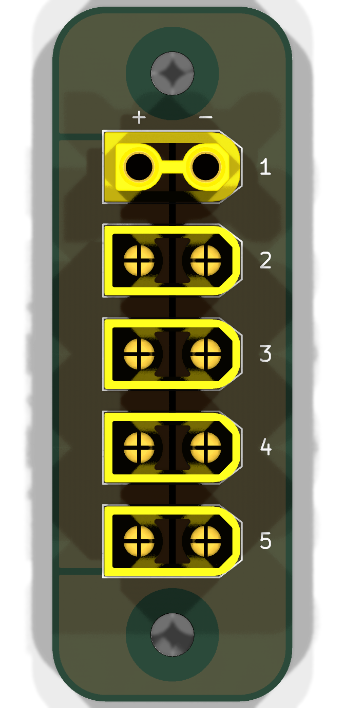
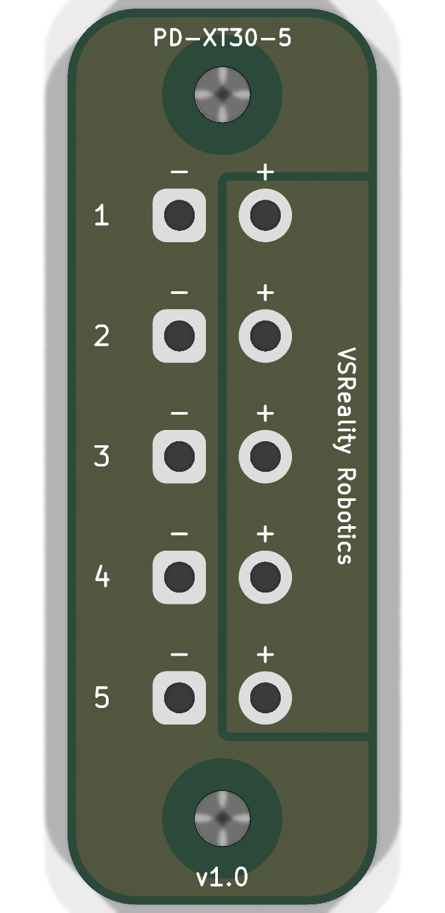

# PD-XT30-5 v1.0

VSReality Robotics five-port XT30 power distribution board. All five ports share a passive parallel bus; the intended arrangement is one supply and four loads.

## Board

- 18 x 52 mm, 1.6 mm FR4, two copper layers with 70 um (2 oz) copper per side.
- Two 3.2 mm non-plated M3 mounting holes, 42 mm centre-to-centre.
- Five centred XT30UPB connectors, spaced 7 mm apart and numbered 1-5.
- Port 1: XT30UPB-F; ports 2-5: XT30UPB-M. Confirm connector gender against the intended harness.
- Positive copper occupies the left strip when viewed from the front. Ground fills the remaining available area on both layers; mounting keepouts remain copper-free.
- Branding, model name and v1.0 are printed on the back.

| Front | Back |
| --- | --- |
|  |  |

[Angled 3D view](preview-3d-assembled.png)

## Files

Open `xt30-distribution.kicad_pro` in KiCad 9. The PCB, schematic and project-relative connector STEP models are included.

- `production/`: Gerbers, separate PTH/NPTH drills, IPC-D-356 netlist, fabrication instructions and SHA-256 manifest.
- `PD-XT30-5-v1.0-Production.zip`: verified bare-board manufacturing package.
- `fabrication/`: matching fabrication files and drill maps.
- `DESIGN-NOTES.txt`: mechanical, electrical and fabrication details.
- `drc-report.txt`, `erc-report.txt`, `production-verification.txt`: validation results.
- `models/MODEL-SOURCES.txt`: third-party model provenance; no additional license is asserted for those models.

## Validation

KiCad 9.0.6 DRC/ERC reported zero violations, with no unconnected pads or schematic parity issues. Connector positions, copper keepouts, drill coordinates, IPC polarity, Gerber dimensions and manufacturing archive integrity were checked.

Physical mating-cable access and loaded thermal performance remain unverified. No current or voltage rating has been established. The board has no fuse, reverse-polarity protection or voltage regulation.

## Rebuild

On Windows with KiCad 9 installed:

```powershell
& 'C:\Program Files\KiCad\9.0\bin\python.exe' build_board.py
```

The generator rewrites the PCB, schematic and project. After changing the layout, rerun DRC/ERC and regenerate production exports and previews before ordering. The generator uses KiCad's installed standard footprint and symbol libraries. In the 3D viewer, enable through-hole models if they are hidden.
